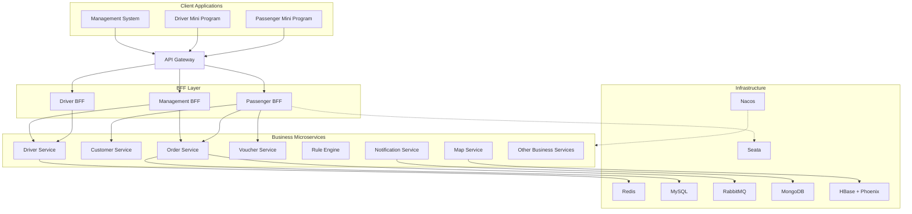

# Zhixing Designated Driving Platform

<p align="center">
  <strong>A Full-Stack Designated Driving Service Platform Built with Spring Cloud Alibaba</strong>
</p>

<p align="center">
  
  
  
  
  
</p>

## Introduction

**Zhixing Designated Driving Platform** is a full-stack designated driving service platform designed to connect passengers, drivers, and platform administrators.

The platform provides three main applications:

- **Passenger Mini Program** – Passengers can create driving orders, track drivers, make payments, and manage their trips.
- **Driver Mini Program** – Drivers can receive orders, accept requests, navigate routes, manage earnings, and track their performance.
- **Management Information System (MIS)** – Administrators can manage users, drivers, orders, payments, reviews, and platform operations.

The backend is built on a microservices architecture powered by Spring Cloud Alibaba, consisting of 14 business microservices, an API Gateway, and shared common modules.

The platform covers the complete designated driving business lifecycle, from order creation and intelligent driver matching to trip execution, payment processing, automated profit sharing, and operational risk management.

## Key Features

### 1. Passenger Services

- Passenger registration and authentication.
- Designated driving order creation.
- Real-time driver location tracking.
- Order status tracking.
- Order cancellation and management.
- Voucher and discount management.
- WeChat Mini Program payment.
- Trip history and billing details.

### 2. Driver Services

- Driver registration and identity verification.
- Driver online/offline management.
- Real-time location reporting.
- Nearby order discovery.
- Real-time order notifications.
- Order acceptance and execution.
- GPS trajectory recording.
- Earnings and wallet management.
- Driver rewards and incentives.

### 3. Intelligent Order Dispatching

- Redis GEO-based nearby driver discovery.
- Configurable driver matching radius.
- Driver availability verification.
- Intelligent order filtering.
- RabbitMQ-based order notifications.
- Redis Lua scripts for atomic order grabbing.
- Prevention of duplicate order acceptance.
- Automatic cleanup of expired orders.

### 4. Order Management

- Complete order lifecycle management.
- Order status transitions.
- Order assignment and acceptance.
- Trip execution monitoring.
- GPS trajectory tracking.
- Actual driving distance calculation.
- Automatic fare calculation.
- Order settlement and billing.

### 5. WeChat Payment and Profit Sharing

- WeChat Pay API V3 integration.
- Mini Program payment initiation.
- Payment notification verification and decryption.
- Payment status synchronization.
- Voucher validation and deduction.
- Driver income distribution.
- Automated profit-sharing processing.
- Payment reconciliation and retry mechanisms.

### 6. AI-Powered Safety Monitoring

- Passenger-driver voice recording.
- Speech-to-text conversion.
- AI-powered content moderation.
- Detection of inappropriate or dangerous content.
- Order-level safety monitoring.
- Risk assessment and management.

### 7. Management Information System

- Passenger management.
- Driver management.
- Driver identity verification.
- Order management.
- Order trajectory playback.
- Financial and wallet management.
- Voucher management.
- System notifications.
- Operational monitoring.

## System Architecture

The platform adopts a distributed microservices architecture.



### Architecture Highlights

- **Microservices Architecture:** Business capabilities are separated into independent services.
- **BFF Pattern:** Different client applications use dedicated backend-for-frontend layers.
- **API Gateway:** Provides a unified external access point.
- **Service Discovery:** Nacos manages service registration and discovery.
- **Inter-Service Communication:** OpenFeign handles internal service communication.
- **Distributed Transactions:** Seata AT ensures transactional consistency across services.
- **Centralized Configuration:** Nacos provides centralized configuration management.

## Technology Stack

### Backend

| Technology | Purpose |
|---|---|
| Java 17 | Programming language |
| Spring Boot 3.5 | Application framework |
| Spring Cloud 2025 | Microservices framework |
| Spring Cloud Alibaba | Microservices ecosystem |
| Spring Cloud Gateway | API Gateway |
| OpenFeign | Service-to-service communication |
| Nacos | Service discovery and configuration |
| MyBatis | Persistence framework |
| Sa-Token | Authentication and authorization |
| Seata AT | Distributed transactions |
| Sentinel | Traffic control and rate limiting |

### Data Storage

| Technology | Purpose |
|---|---|
| MySQL 8.0 | Relational data storage |
| Redis | Caching and GEO-based location queries |
| MongoDB | System messages and notification storage |
| HBase | Large-scale GPS trajectory storage |
| Apache Phoenix | SQL access to HBase |

### Messaging and Scheduling

| Technology | Purpose |
|---|---|
| RabbitMQ | Asynchronous messaging |
| RabbitMQ TTL | Delayed message processing |
| Dead Letter Queue | Delayed task triggering |
| XXL-JOB | Distributed scheduled jobs |
| Spring @Async | Asynchronous execution |

### Third-Party Integrations

| Technology | Purpose |
|---|---|
| WeChat Pay V3 | Online payment and profit sharing |
| Tencent Location Services | Route planning and distance estimation |
| Tencent Cloud COS | File storage |
| Tencent Cloud CI | Image and text content moderation |
| Tencent Cloud Face Recognition | Identity verification |
| Baidu OCR | ID card and driving license recognition |
| WeChat Speech Services | Voice recognition and speech processing |
| MinIO | Private object storage |

### Frontend

| Technology | Purpose |
|---|---|
| uni-app | Passenger and driver Mini Programs |
| Vue 2 | Management frontend |
| Element UI | Management interface components |
| Tencent Maps JavaScript SDK | Map visualization |

### Monitoring and Observability

| Technology | Purpose |
|---|---|
| Prometheus | Metrics collection |
| Grafana | Monitoring dashboards |
| SkyWalking | Distributed tracing |
| QLExpress | Business rule engine |

## Core Business Workflows

### 1. Order Creation and Driver Matching

1. A passenger creates a designated driving order.
2. The backend calculates the estimated distance and fare.
3. Redis GEO searches for nearby available drivers.
4. The system filters drivers according to matching rules.
5. RabbitMQ sends order notifications to eligible drivers.
6. Drivers compete to accept the order.
7. Redis Lua scripts guarantee atomic order acceptance.
8. The order is assigned to one driver.

### 2. Trip Execution and GPS Tracking

1. The driver starts the designated driving service.
2. The driver application collects GPS location points.
3. Location points are uploaded in batches.
4. GPS trajectories are stored in HBase.
5. Phoenix provides SQL-based access to trajectory data.
6. The system calculates the actual driving distance.
7. The final distance is used for fare settlement.

### 3. Payment and Profit Sharing

1. The passenger requests payment.
2. The backend validates the order status.
3. The system checks the selected voucher.
4. The actual payment amount is calculated.
5. The backend creates a WeChat Pay transaction.
6. The prepayment ID is saved to the order.
7. The passenger Mini Program invokes WeChat payment.
8. WeChat sends an asynchronous payment notification.
9. The backend verifies the notification signature and decrypts the payment data.
10. The order is updated to the paid state.
11. RabbitMQ triggers delayed profit-sharing processing.
12. XXL-JOB provides scheduled reconciliation for unfinished transactions.

## Important Engineering Practices

### High-Concurrency Order Grabbing

Redis Lua scripts are used to ensure atomic order-grabbing operations.

The system performs order status verification and driver assignment within a single atomic Redis operation, preventing multiple drivers from accepting the same order.

### GPS Trajectory Processing

GPS trajectory data is stored in HBase and accessed through Phoenix.

The Haversine formula is used to calculate distances between consecutive GPS points. Small GPS movements are filtered to reduce location drift errors.

### Distributed Transaction Management

Seata AT is used to manage distributed transactions across multiple business services.

This helps maintain consistency when an operation involves multiple services, such as order creation, voucher usage, billing, and payment processing.

### Reliable Asynchronous Processing

RabbitMQ delayed messages and dead-letter queues are used to decouple payment notifications from profit-sharing operations.

XXL-JOB periodically checks unfinished profit-sharing records and performs reconciliation.

### Security and Risk Control

- Sa-Token-based authentication.
- XSS request filtering.
- Payment callback signature verification.
- Idempotent payment processing.
- Abnormal order detection.
- Voucher abuse prevention.
- AI-powered voice content moderation.

## Project Modules

The backend is organized into independent business services.

Representative modules include:

| Module | Responsibility |
|---|---|
| Gateway | Unified API entry point |
| BFF Customer | Passenger-facing business aggregation |
| BFF Driver | Driver-facing business aggregation |
| BFF MIS | Management-facing business aggregation |
| zxds-odr | Order and billing management |
| zxds-vhr | Voucher management |
| zxds-dr | Driver and wallet services |
| zxds-cst | Passenger services |
| zxds-rule | Business rules and pricing |
| zxds-snm | System notifications |
| zxds-nebula | GPS trajectory and monitoring data |
| Common | Shared components and infrastructure integrations |

The complete platform contains additional business services.

## Getting Started

### Prerequisites

Before running the project, make sure the following software and infrastructure are available.

- JDK 17
- Maven
- MySQL 8.0
- Redis
- Nacos
- RabbitMQ
- MongoDB
- HBase and Phoenix
- Seata Server
- XXL-JOB Admin
- Node.js
- HBuilderX (for uni-app development)

Some infrastructure components are only required when running their corresponding business modules.

### Configuration

Configure the required infrastructure connection information in Nacos.

Typical configuration items include:

- MySQL connection settings.
- Redis connection settings.
- RabbitMQ connection settings.
- MongoDB connection settings.
- HBase connection settings.
- Seata transaction configuration.
- WeChat Pay API V3 credentials.
- Third-party API credentials.

Example WeChat Pay configuration:

```yaml
wx:
  app-id: YOUR_WECHAT_APP_ID
  app-secret: YOUR_WECHAT_APP_SECRET
  mch-id: YOUR_MERCHANT_ID
  api-v3-key: YOUR_API_V3_KEY
  private-key-path: YOUR_PRIVATE_KEY_PATH
  merchant-serial-number: YOUR_MERCHANT_SERIAL_NUMBER
```

**Important:** Never commit real API keys, merchant private keys, passwords, or other sensitive credentials to a public repository.

### Running the Backend

A typical startup process is:

1. Start MySQL, Redis, RabbitMQ, and other required infrastructure.
2. Start Nacos.
3. Start Seata Server.
4. Start XXL-JOB Admin.
5. Configure the application settings in Nacos.
6. Build the shared Common module.
7. Start the business microservices.
8. Start the BFF services.
9. Start the API Gateway.

The exact startup order may vary depending on service dependencies.

### Running the Frontend

**Passenger and Driver Mini Programs**

1. Open the corresponding uni-app projects in HBuilderX.
2. Configure the backend API base URL.
3. Configure the required WeChat Mini Program AppID.
4. Install dependencies if necessary.
5. Run the project in the WeChat Developer Tools.

**Management System**

1. Navigate to the MIS frontend directory.
2. Install dependencies.
3. Configure the backend API address.
4. Start the Vue development server.

```bash
npm install
npm run serve
```

The exact commands depend on the frontend project configuration.

## API Documentation

The backend provides RESTful APIs for business operations.

SpringDoc OpenAPI annotations are used to describe API endpoints, request parameters, and response structures.

API documentation is available through the Swagger UI endpoint configured by each service.

## Project Highlights

- Full-stack designated driving business implementation.
- Spring Cloud Alibaba microservices architecture.
- BFF-based API aggregation.
- Redis GEO for intelligent nearby driver matching.
- Redis Lua for high-concurrency order grabbing.
- RabbitMQ for asynchronous event processing.
- Seata for distributed transaction management.
- WeChat Pay V3 integration.
- Automated driver profit sharing.
- HBase-based GPS trajectory storage.
- AI-powered voice safety monitoring.
- Distributed scheduled jobs and payment reconciliation.
- Prometheus, Grafana, and SkyWalking observability.

## Future Improvements

Potential areas for further development include:

- Improving service resilience and fault tolerance.
- Expanding automated integration tests.
- Improving API documentation.
- Strengthening distributed transaction monitoring.
- Optimizing high-concurrency order dispatching.
- Enhancing payment reconciliation and exception handling.
- Improving deployment automation and container orchestration.

## License

This project is intended for learning, development, and demonstration purposes.

Add an appropriate open-source license before distributing the project publicly.

## Acknowledgements

Thanks to the open-source communities and third-party platforms that provide the technologies and services used in this project.

